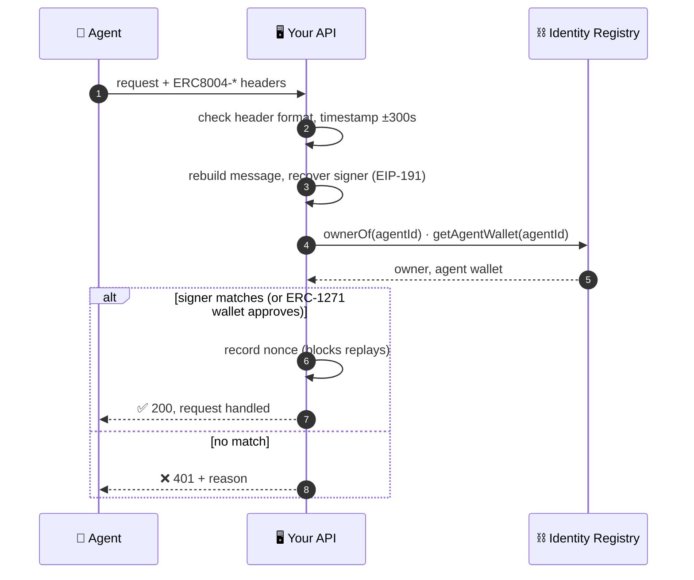

<div align="center">

<picture>
  <source media="(prefers-color-scheme: dark)" srcset="docs/assets/hero-dark.svg">
  
</picture>

<br>

[](https://github.com/EfajTahamidRifat/erc8004-agent-auth/actions/workflows/ci.yml)
[](LICENSE)
[](SPEC.md)
[](python)
[](js)
[](https://eips.ethereum.org/EIPS/eip-8004)

**[Spec](SPEC.md)** · **[Python](python)** · **[JavaScript](js)** · **[Test vectors](vectors/v1.json)** · **[Roadmap](#-roadmap)**

</div>

---

AI agents now call APIs, pay for services ([x402](https://www.x402.org)) and talk to each other (A2A, MCP).
[ERC-8004](https://eips.ethereum.org/EIPS/eip-8004) gives every agent an **on-chain identity**, but an HTTP request still
has no standard way to prove *which* agent sent it. Servers either trust a self-reported name or hand out API keys,
which defeats the point of open, permissionless agents.

**erc8004-agent-auth** is a small open standard plus two reference libraries that close that gap.

<picture>
  <source media="(prefers-color-scheme: dark)" srcset="docs/assets/flow-dark.svg">
  
</picture>

## ✨ Why it's different

<table>
<tr>
<td width="33%" valign="top">

### 🔑 No API keys
The agent's identity *is* its ERC-8004 registration. There's nothing to issue, rotate or leak.

</td>
<td width="33%" valign="top">

### ⛓️ No middleman
Servers read the canonical Identity Registry directly over JSON-RPC. There's no account and no vendor in the loop.

</td>
<td width="33%" valign="top">

### 🛡️ Hard to fake
Each signature covers the method, URL, body, timestamp and a one-time nonce, so it can't be replayed or reused.

</td>
</tr>
<tr>
<td valign="top">

### 👛 Smart wallets
Works with plain wallets (EIP-191) and contract wallets (ERC-1271), such as Safe and smart accounts.

</td>
<td valign="top">

### 🔁 Safe on transfer
ERC-8004 clears the agent wallet when an agent is sold, so old keys stop working straight away.

</td>
<td valign="top">

### 🌍 Runs anywhere
Python 3.10+, Node 18+, Bun, Deno, Cloudflare Workers and browsers, with shared byte-exact test vectors.

</td>
</tr>
</table>

## 🚀 Quick start

```bash
pip install erc8004-agent-auth          # Python
npm install erc8004-agent-auth ethers   # JavaScript / TypeScript
```

### 1 · The agent signs

<details open>
<summary><b>Python</b></summary>

```python
from erc8004_agent_auth import sign_request
import requests

body = b'{"amount":"10","asset":"USDC"}'
headers = sign_request(AGENT_PRIVATE_KEY, "eip155:8453:1203", "POST", "https://api.example.com/orders", body)
requests.post("https://api.example.com/orders", data=body,
              headers={**headers, "Content-Type": "application/json"})
```

</details>

<details>
<summary><b>JavaScript</b></summary>

```js
import { signRequest } from "erc8004-agent-auth";

const body = JSON.stringify({ amount: "10", asset: "USDC" });
const headers = await signRequest(wallet /* ethers Signer or key */, "eip155:8453:1203", "POST",
  "https://api.example.com/orders", body);
await fetch("https://api.example.com/orders", {
  method: "POST", body, headers: { ...headers, "content-type": "application/json" },
});
```

</details>

The request now carries four headers:

```http
ERC8004-Agent:     eip155:8453:1203
ERC8004-Timestamp: 1767225600
ERC8004-Nonce:     q3V9xk2LmP0aZ7rT_8wYb-1c
ERC8004-Signature: 0x4f1c…9b1b
```

> [!IMPORTANT]
> The private key stays in the agent's own environment or signer (KMS, hardware wallet, smart account). It is never sent anywhere.

### 2 · Your server verifies

<details open>
<summary><b>Flask</b></summary>

```python
from flask import Flask, request, abort, g
from erc8004_agent_auth import Verifier

verifier = Verifier({8453: "https://YOUR-BASE-RPC", 1: "https://YOUR-MAINNET-RPC"})

@app.before_request
def require_agent():
    result = verifier.verify(request.headers, request.method, request.url, request.get_data())
    if not result:
        abort(401, result.reason)
    g.agent = result.agent          # "eip155:8453:1203"
```

</details>

<details>
<summary><b>Express</b></summary>

```js
import express from "express";
import { Verifier } from "erc8004-agent-auth";

const verifier = new Verifier({ rpcUrls: { 8453: process.env.BASE_RPC, 1: process.env.MAINNET_RPC } });
const app = express();
app.use(express.raw({ type: "*/*" }));            // the signature covers the raw body
app.use(async (req, res, next) => {
  const url = `${req.protocol}://${req.get("host")}${req.originalUrl}`;
  const result = await verifier.verify(req.headers, req.method, url, req.body?.length ? req.body : "");
  if (!result.ok) return res.status(401).json({ error: result.reason });
  req.agent = result.agent;
  next();
});
```

</details>

Every result tells you exactly what happened:

```jsonc
{
  "ok": true,
  "reason": "verified",
  "agent": "eip155:8453:1203",
  "signer": "0xAbC…123",
  "role": "agent_wallet",          // or "owner"
  "checks": ["timestamp is fresh", "signed by the agent's verified agent wallet", "nonce is new"]
}
```

## 🔗 Delegation chains <sup>new in 0.2</sup>

When one agent hires another, the hired agent can prove **who it is working for**. Agent A signs a short,
expiring delegation to agent B (limited to a URL prefix and HTTP methods), and B attaches it to its requests.
Chains can go up to 4 hops (A → B → C → D), and every hop is checked against the Identity Registry.

```python
from erc8004_agent_auth import sign_delegation, sign_request, join_chain

# Agent A (eip155:8453:1203) lets agent B (eip155:8453:77) call one API for an hour
token = sign_delegation(A_KEY, "eip155:8453:1203", "eip155:8453:77",
                        scope="https://api.example.com/v1/", methods="POST", lifetime=3600)

headers = sign_request(B_KEY, "eip155:8453:77", "POST", url, body)
headers["ERC8004-Delegation"] = join_chain([token])
```

The verifier's result then says who the request is really for:

```jsonc
{ "ok": true, "agent": "eip155:8453:77", "principal": "eip155:8453:1203",
  "delegation_chain": ["eip155:8453:1203", "eip155:8453:77"] }
```

Delegations expire (30 days at most), can be limited to a URL prefix and methods, and can be revoked with your own
deny-list through the `is_revoked` hook. Full rules: [SPEC.md §8](SPEC.md#8-delegation-chains--erc8004-delegation1).

## 🔍 How verification works



> [!NOTE]
> A valid signature proves **who** sent the request. It does **not** say whether the agent is trustworthy.
> Combine it with ERC-8004 reputation and validation data and your own limits.

## ⚙️ Options

| Option | Default | What it does |
|---|---|---|
| `allow_owner` · `allowOwner` | `true` | Also accept signatures from the agent NFT's owner |
| `max_skew` · `maxSkew` | `300` | Allowed clock difference in seconds (can only be lowered) |
| `nonce_store` · `nonceStore` | in memory | Anything with `use(key, now) → bool`. Use Redis `SET NX EX` or a unique DB index when you run several servers |
| `registries` | canonical address | `IdentityRegistry(rpc_url, address=…)` for testnets or custom deployments |
| `protocol` | `erc8004-agent-auth/1` | Verify a vendor-prefixed variant of the same message format |

<details>
<summary><b>📍 Canonical ERC-8004 registries</b></summary>

<br>

The same addresses on every supported mainnet:

| Registry | Address |
|---|---|
| Identity | `0x8004A169FB4a3325136EB29fA0ceB6D2e539a432` |
| Reputation | `0x8004BAa17C55a88189AE136b182e5fdA19dE9b63` |
| Validation | `0x8004Cc8439f36fd5F9F049D9fF86523Df6dAAB58` |

</details>

## 🛡️ Security

- **Fails closed.** If the RPC is down or returns garbage, the request is rejected.
- **Cheap to reject junk.** Timestamps and header formats are checked before any RPC call.
- **Nonces can't be burned.** A nonce is stored only after the signature checks out.
- **Behind a proxy?** Verify against the public URL the client called, not the internal one.
- **Trust your RPC.** Use your own node or a provider you pay; the verifier believes what it returns.

Found a problem? Please open a private security advisory on this repo rather than a public issue.

## 🗺️ Roadmap

- [x] `erc8004-agent-auth/1` spec draft
- [x] Python and JavaScript reference libraries
- [x] Shared test vectors and CI on 3 Python and 3 Node versions
- [x] Delegation chains (`erc8004-delegation/1`): agents acting for other agents, verified at every hop
- [ ] Framework middleware: FastAPI, Express/Hono, Next.js, plus an MCP-server helper
- [ ] Live integration tests against the Base and Ethereum mainnet registries, plus Foundry fork tests for ERC-1271
- [ ] Multi-RPC quorum reads and caching, so one bad RPC can't lie about an agent
- [ ] An x402 extension so paid requests carry the paying agent's identity
- [ ] Propose the header format to the ERC-8004 community as a companion standard

## 🤝 Contributing

Issues, pull requests and new implementations in other languages are welcome. Any implementation must reproduce
[`vectors/v1.json`](vectors/v1.json) byte for byte.

```bash
# Python
cd python && pip install -e ".[test]" && pytest
# JavaScript
cd js && npm install && npm test
```

<div align="center">
<br>
<sub>MIT licensed · Spec released under CC0 · Built for the open agent economy on Ethereum</sub>
</div>
